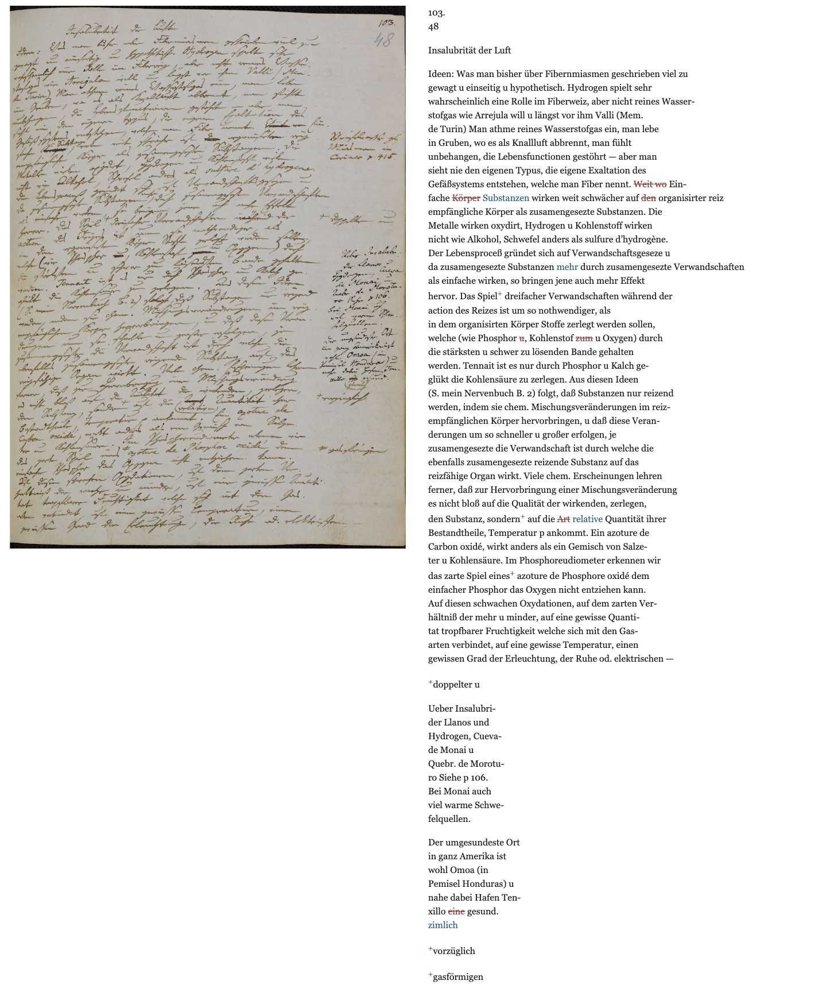
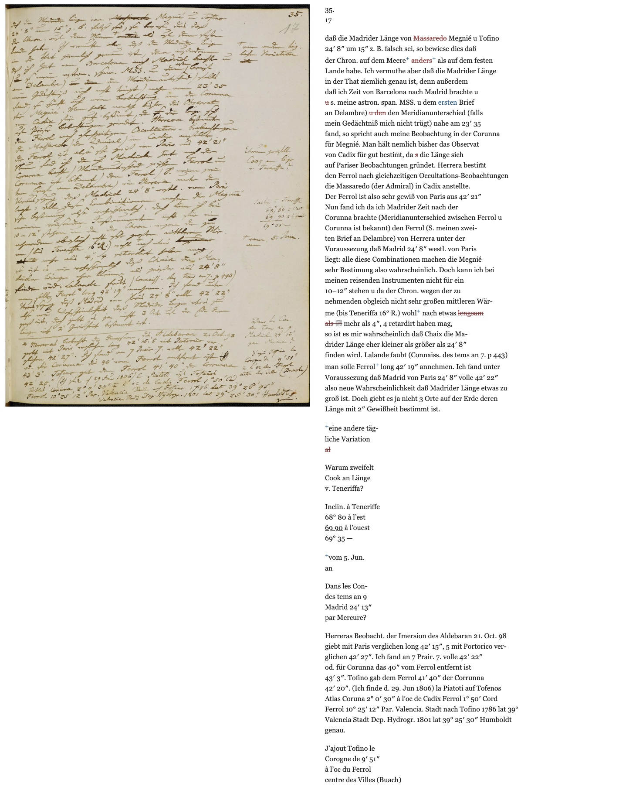
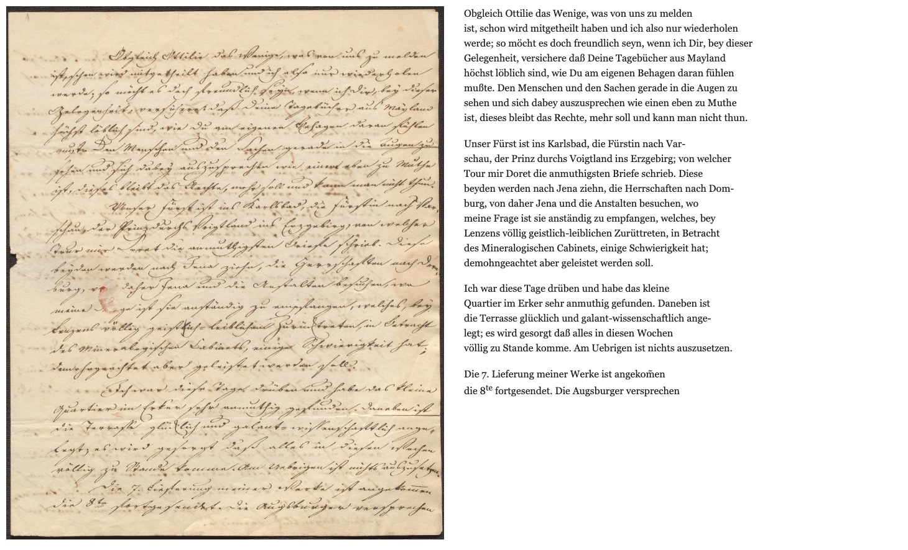

# LightOnOCR-3-1B · Historic German Handwriting

A fine-tune of [LightOnOCR-3-1B](https://huggingface.co/lightonai/LightOnOCR-3-1B) that reads **whole pages of
historic handwriting** — German Kurrent and Latin-script hands, mainly of the 19th century (the training pages run from
the 1790s to the mid-20th century, most of them 1820–1880): letters, minutes, land registers, lecture notes and diaries.
It writes the page **as written**, line by line in reading order: the words in their spelling on the page, nothing
expanded or normalised, struck, inserted, underlined, superscript and subscript text kept as inline marks. One image in,
the whole page out — no line segmentation or layout step before the recognition, as in line-based HTR pipelines
(e.g. Transkribus). Trained only on openly licensed editions and archives (list and attribution below).

**Try it in your browser: [OCR Lite](https://b-straub.github.io/historic-htr-ocr/app/)** · GitHub: https://github.com/b-straub/historic-htr-ocr ·
Background: [b-straub.github.io/historic-htr-ocr](https://b-straub.github.io/historic-htr-ocr/)

| | |
|---|---|
| Base | `lightonai/LightOnOCR-3-1B` @ `23d5440` (Apache-2.0) |
| Trained | vision encoder + projector (410 M of 1.0 B parameters); the language model is frozen |
| Input | one page image, cropped to the paper, longest edge 1540 px, colour |
| Output | plain text with the inline marks of [Output format](#output-format) |
| Files | safetensors (Transformers, vLLM) · GGUF pair `text-q8_0.gguf` + `mmproj-bf16.gguf` (llama.cpp, the browser app) |
| Val (610 pages) | CER 4.74 % · oCER 3.85 % · 2 runaway pages (decoding `greedy_rp1.1`, [Evaluation](#evaluation)) |




*Alexander von Humboldt, notes of 1799 (Staatsbibliothek zu Berlin, Public Domain Mark) — a validation page, never
trained on. The model's output as read (`greedy_rp1.1`), not proofread, rendered by `convert_output.py`: struck text
red, insertions blue, marginal notes after the main text. CER 5.1 %, oCER 3.4 %.
[Open interactively](https://b-straub.github.io/historic-htr-ocr/examples/humboldt_48r.html)*

<details><summary>Raw model output of this page</summary>

    103.
    48

    Insalubrität der Luft

    Ideen: Was man bisher über Fibernmiasmen geschrieben viel zu
    gewagt u einseitig u hypothetisch. Hydrogen spielt sehr
    wahrscheinlich eine Rolle im Fiberweiz, aber nicht reines Wasser-
    stofgas wie Arrejula will u längst vor ihm Valli (Mem.
    de Turin) Man athme reines Wasserstofgas ein, man lebe
    in Gruben, wo es als Knallluft abbrennt, man fühlt
    unbehangen, die Lebensfunctionen gestöhrt — aber man
    sieht nie den eigenen Typus, die eigene Exaltation des
    Gefäßsystems entstehen, welche man Fiber nennt. ⟦Weit wo⟧ Ein-
    fache ⟦Körper⟧ ⟨Substanzen⟩ wirken weit schwächer auf ⟦den⟧ organisirter reiz
    empfängliche Körper als zusamengesezte Substanzen. Die
    Metalle wirken oxydirt, Hydrogen u Kohlenstoff wirken
    nicht wie Alkohol, Schwefel anders als sulfure d’hydrogène.
    Der Lebensproceß gründet sich auf Verwandschaftsgeseze u
    da zusamengesezte Substanzen ⟨mehr⟩ durch zusamengesezte Verwandschaften
    als einfache wirken, so bringen jene auch mehr Effekt
    hervor. Das Spiel⌈+⌉ dreifacher Verwandschaften während der
    action des Reizes ist um so nothwendiger, als
    in dem organisirten Körper Stoffe zerlegt werden sollen,
    welche (wie Phosphor ⟦u⟧, Kohlenstof ⟦zum⟧ u Oxygen) durch
    die stärksten u schwer zu lösenden Bande gehalten
    werden. Tennait ist es nur durch Phosphor u Kalch ge-
    glükt die Kohlensäure zu zerlegen. Aus diesen Ideen
    (S. mein Nervenbuch B. 2) folgt, daß Substanzen nur reizend
    werden, indem sie chem. Mischungsveränderungen im reiz-
    empfänglichen Körper hervorbringen, u daß diese Veran-
    derungen um so schneller u großer erfolgen, je
    zusamengesezte die Verwandschaft ist durch welche die
    ebenfalls zusamengesezte reizende Substanz auf das
    reizfähige Organ wirkt. Viele chem. Erscheinungen lehren
    ferner, daß zur Hervorbringung einer Mischungsveränderung
    es nicht bloß auf die Qualität der wirkenden, zerlegen,
    den Substanz, sondern⌈+⌉ auf die ⟦Art⟧ ⟨relative⟩ Quantität ihrer
    Bestandtheile, Temperatur p ankommt. Ein azoture de
    Carbon oxidé, wirkt anders als ein Gemisch von Salze-
    ter u Kohlensäure. Im Phosphoreudiometer erkennen wir
    das zarte Spiel eines⌈+⌉ azoture de Phosphore oxidé dem
    einfacher Phosphor das Oxygen nicht entziehen kann.
    Auf diesen schwachen Oxydationen, auf dem zarten Ver-
    hältniß der mehr u minder, auf eine gewisse Quanti-
    tat tropfbarer Fruchtigkeit welche sich mit den Gas-
    arten verbindet, auf eine gewisse Temperatur, einen
    gewissen Grad der Erleuchtung, der Ruhe od. elektrischen —

    ⌈+⌉doppelter u

    Ueber Insalubri-
    der Llanos und
    Hydrogen, Cueva-
    de Monai u
    Quebr. de Morotu-
    ro Siehe p 106.
    Bei Monai auch
    viel warme Schwe-
    felquellen.

    Der umgesundeste Ort
    in ganz Amerika ist
    wohl Omoa (in
    Pemisel Honduras) u
    nahe dabei Hafen Ten-
    xillo ⟦eine⟧ gesund.
    ⟨zimlich⟩

    ⌈+⌉vorzüglich

    ⌈+⌉gasförmigen


</details>

<details><summary>Another page — Humboldt 1799, CER 3.1 %</summary>



*Alexander von Humboldt, notes of 1799 (Staatsbibliothek zu Berlin, Public Domain Mark) — a validation page, never
trained on; the model's output as read (`greedy_rp1.1`), not proofread. CER 3.1 %, oCER 2.7 %.
[Open interactively](https://b-straub.github.io/historic-htr-ocr/examples/humboldt_17r.html)*

<details><summary>Raw model output of this page</summary>

    35.
    17

    daß die Madrider Länge von ⟦Massaredo⟧ Megnié u Tofino
    24′ 8″ um 15″ z. B. falsch sei, so bewiese dies daß
    der Chron. auf dem Meere⌈+⌉ ⟦anders⟧⌈+⌉ als auf dem festen
    Lande habe. Ich vermuthe aber daß die Madrider Länge
    in der That ziemlich genau ist, denn außerdem
    daß ich Zeit von Barcelona nach Madrid brachte u
    ⟦u⟧ s. meine astron. span. MSS. u dem ⟨ersten⟩ Brief
    an Delambre) ⟦u den⟧ den Meridianunterschied (falls
    mein Gedächtniß mich nicht trügt) nahe am 23′ 35
    fand, so spricht auch meine Beobachtung in der Corunna
    für Megnié. Man hält nemlich bisher das Observat
    von Cadix für gut bestim̅t, da ⟦s⟧ die Länge sich
    auf Pariser Beobachtungen gründet. Herrera bestim̅t
    den Ferrol nach gleichzeitigen Occultations-Beobachtungen
    die Massaredo (der Admiral) in Cadix anstellte.
    Der Ferrol ist also sehr gewiß von Paris aus 42′ 21″
    Nun fand ich da ich Madrider Zeit nach der
    Corunna brachte (Meridianunterschied zwischen Ferrol u
    Corunna ist bekannt) den Ferrol (S. meinen zwei-
    ten Brief an Delambre) von Herrera unter der
    Voraussezung daß Madrid 24′ 8″ westl. von Paris
    liegt: alle diese Combinationen machen die Megnié
    sehr Bestimung also wahrscheinlich. Doch kann ich bei
    meinen reisenden Instrumenten nicht für ein
    10–12″ stehen u da der Chron. wegen der zu
    nehmenden obgleich nicht sehr großen mittleren Wär-
    me (bis Teneriffa 16° R.) wohl⌈+⌉ nach etwas ⟦lengsam⟧
    ⟦als ▨⟧ mehr als 4″, 4 retardirt haben mag,
    so ist es mir wahrscheinlich daß Chaix die Ma-
    drider Länge eher kleiner als größer als 24′ 8″
    finden wird. Lalande faubt (Connaiss. des tems an 7. p 443)
    man solle Ferrol⌈+⌉ long 42′ 19″ annehmen. Ich fand unter
    Voraussezung daß Madrid von Paris 24′ 8″ volle 42′ 22″
    also neue Wahrscheinlichkeit daß Madrider Länge etwas zu
    groß ist. Doch giebt es ja nicht 3 Orte auf der Erde deren
    Länge mit 2″ Gewißheit bestimmt ist.

    ⌈+⌉eine andere täg-
    liche Variation
    ⟦al⟧

    Warum zweifelt
    Cook an Länge
    v. Teneriffa?

    Inclin. à Teneriffe
    68° 80 à l’est
    〔69 90〕 à l’ouest
    69° 35 —

    ⌈+⌉vom 5. Jun.
    an

    Dans les Con-
    des tems an 9
    Madrid 24′ 13″
    par Mercure?

    Herreras Beobacht. der Imersion des Aldebaran 21. Oct. 98
    giebt mit Paris verglichen long 42′ 15″, 5 mit Portorico ver-
    glichen 42′ 27″. Ich fand an 7 Prair. 7. volle 42′ 22″
    od. für Corunna das 40″ vom Ferrol entfernt ist ⟦⟧
    43′ 3″. Tofino gab dem Ferrol 41′ 40″ der Corrunna
    42′ 20″. (Ich finde d. 29. Jun 1806) la Piatoti auf Tofenos
    Atlas Coruna 2° 0′ 30″ à l’oc de Cadix Ferrol 1° 50′ Cord
    Ferrol 10° 25′ 12″ Par. Valencia. Stadt nach Tofino 1786 lat 39°
    Valencia Stadt Dep. Hydrogr. 1801 lat 39° 25′ 30″ Humboldt
    genau.

    J’ajout Tofino le
    Corogne de 9′ 51″
    à l’oc du Ferrol
    centre des Villes (Buach)


</details>

</details>

<details><summary>A page from outside all training material — Goethe, 1830, CER 1.35 %</summary>



*Johann Wolfgang von Goethe to his son August, 25–29 June 1830 (Badische Landesbibliothek Karlsruhe, K 703, Public Domain
Mark). Not part of any training or validation set. Against a transcription corrected by the author: 18 character errors
on 1,333 characters (CER 1.35 %) — mostly single letters in names and rare words (Soret → Doret, Dornburg → Domburg).
[Open interactively](https://b-straub.github.io/historic-htr-ocr/examples/goethe_blb_6171314.html)*

</details>

## Intended use

**For** archivists, historians, editors and genealogists who need a first, searchable transcription of handwritten
German pages of the late 18th to mid-20th century: to find a name, a date or a passage in large holdings, to index a
collection, or to start an edition from a draft instead of from scratch. The output follows the page as written — in
page order, with strike-outs and insertions marked — so a reader can check it line by line against the image.

**Out of scope**
- **Not an edition.** No expansions, no normalisation, no identification of hands, persons or places, no apparatus.
- **Not a source of facts.** Names, dates, numbers and places must be checked against the image before they are cited or
  used to link records; a single misread digit changes a date.
- **Beyond the training material** it still reads well, but less reliably. The base model's knowledge stays
  present: printed pages read well, though slightly below the base model — for modern print a standard OCR model is
  the better choice. It transfers to a wide range of other hands, modern handwriting included, and to historic print to
  some extent; quality drops for very individual hands unlike anything trained. Not trained: forms and index cards,
  single lines or word snippets, non-Latin scripts.
- **Not the base model.** LightOnOCR's markdown / table / chart output and its grounding mode are not preserved.

## Quick start

The model is called with **the image only, no text prompt** (as the base model's transcription mode). The base
model's `grounding` mode was not trained and is out of distribution here.

Two decoding settings, both measured on all 610 validation pages ([Decoding](#decoding)):
- **Plain** — `generation_config.json` as shipped (temperature 0.1, top_p 0.9): no extra code anywhere. CER 5.09 %.
- **Best** — `greedy_rp1.1`: greedy with a repetition penalty of 1.1 over **the last 20 tokens** only. CER 4.74 %,
  fewer runaways (2 vs 7 pages). OCR Lite has it built in, llama.cpp nearly the same with two flags;
  Transformers and vLLM only offer a whole-context penalty, so they need the small processor shown below.

### Transformers (≥ 5.0)

```python
import torch
from transformers import LightOnOcrForConditionalGeneration, LightOnOcrProcessor, LogitsProcessor, LogitsProcessorList

class WindowRepetitionPenalty(LogitsProcessor):
    """greedy_rp1.1: each distinct token among the last `window` tokens (prompt tail + output):
    logit < 0 → × penalty, else ÷ penalty."""
    def __init__(self, penalty=1.1, window=20):
        self.penalty, self.window = penalty, window

    def __call__(self, input_ids, scores):
        for b in range(input_ids.shape[0]):
            ids = input_ids[b, -self.window:].unique()
            s = scores[b, ids]
            scores[b, ids] = torch.where(s < 0, s * self.penalty, s / self.penalty)
        return scores

model_id = "b-straub/LightOnOCR-3-1B-Historic-German-Handwriting"
model = LightOnOcrForConditionalGeneration.from_pretrained(model_id, dtype=torch.bfloat16).to("cuda")
processor = LightOnOcrProcessor.from_pretrained(model_id)

conversation = [{"role": "user", "content": [{"type": "image", "url": "page.jpg"}]}]
inputs = processor.apply_chat_template(conversation, add_generation_prompt=True, tokenize=True,
                                       return_dict=True, return_tensors="pt").to("cuda")
inputs["pixel_values"] = inputs["pixel_values"].to(torch.bfloat16)
out = model.generate(**inputs, max_new_tokens=7024, do_sample=False,
                     logits_processor=LogitsProcessorList([WindowRepetitionPenalty(1.1, 20)]))
print(processor.decode(out[0, inputs["input_ids"].shape[1]:], skip_special_tokens=True))
```

Transformers logs that a model of type `mistral3` is used to instantiate `lighton_ocr`: the config is the base
model's own (`lightonai/LightOnOCR-3-1B` ships the same), all weights load — the warning is harmless.

### vLLM

The windowed penalty is a small vLLM logits processor, `window_rep_penalty.py`, in this repository next to
`convert_output.py`. Every request must carry `rep_penalty` / `rep_window`, and the built-in `repetition_penalty`
must stay 1.0 — the processor rejects a request otherwise.

```bash
huggingface-cli download b-straub/LightOnOCR-3-1B-Historic-German-Handwriting window_rep_penalty.py --local-dir .
PYTHONPATH=. vllm serve b-straub/LightOnOCR-3-1B-Historic-German-Handwriting \
    --limit-mm-per-prompt '{"image": 1}' --mm-processor-cache-gb 0 --no-enable-prefix-caching \
    --logits-processors window_rep_penalty:WindowRepetitionPenalty
```

```python
import base64, requests

with open("page.jpg", "rb") as f:
    img = base64.b64encode(f.read()).decode()

r = requests.post("http://localhost:8000/v1/chat/completions", json={
    "model": "b-straub/LightOnOCR-3-1B-Historic-German-Handwriting",
    "messages": [{"role": "user", "content": [
        {"type": "image_url", "image_url": {"url": f"data:image/jpeg;base64,{img}"}}]}],
    "temperature": 0, "top_k": 1, "max_tokens": 7024,
    "vllm_xargs": {"rep_penalty": 1.1, "rep_window": 20},
})
print(r.json()["choices"][0]["message"]["content"])
```

On one RTX A4000 (bf16) vLLM read dense manuscript pages in 7.0 s each one at a time, 3.4 s per page with 15 in
parallel.

### GGUF / llama.cpp

Two files: **`text-q8_0.gguf`** (language model, 8-bit, 639 MB) + **`mmproj-bf16.gguf`** (vision encoder +
projector, bf16, 829 MB). The vision encoder ships in **bf16, not f16**: in f16 its activations overflow on CUDA and
the model writes only `!!!!`; bf16 (the trained dtype, same size) reads correctly at full speed. The 8-bit text model
read the same as bf16 on a 15-page test (no measurable loss; a larger comparison is still open).

```bash
llama-mtmd-cli -m text-q8_0.gguf --mmproj mmproj-bf16.gguf --image page.jpg -p '<__media__>' \
    --temp 0 --repeat-penalty 1.1 --repeat-last-n 20 -n 7024
```

`-p '<__media__>'` is the image marker alone, i.e. the image with no text prompt: without `-p` the CLI starts an
interactive chat and does not read `--image`. `--temp 0` is required — the GGUF carries the base model's sampling
defaults (temperature 0.2), which apply otherwise; with `--temp 0` the remaining default filters (top-k, top-p, min-p)
cannot change the pick.

- Tested with llama.cpp `d812350` (Metal, CUDA, Vulkan). Speed on dense pages: RTX A4000 CUDA ≈ 185 tok/s (6 s per
  page) · Apple M3 Metal ≈ 53 tok/s (30 s per page) · CPU only 0.6–1.7 tok/s (not usable for full pages).
- llama.cpp scales **every** image of this model up to 1540 px on its longest edge (Transformers / vLLM only scale
  down), and pads to the 28 px grid in black. Whole pages at 1540 px are unaffected; feed whole pages, not small
  crops.
- `--repeat-penalty 1.1 --repeat-last-n 20` is the same penalty (each distinct token once; logit ≤ 0 → × 1.1, else
  ÷ 1.1) with one difference: the CLI's window holds only generated tokens, so for the first 20 output tokens it does
  not reach back into the prompt tail. OCR Lite applies the exact window itself (not llama.cpp's sampler). In a test on three
  pages, llama.cpp left out one block on one page — for full pages prefer Transformers, vLLM or OCR Lite.

### In the browser: OCR Lite

[OCR Lite](https://b-straub.github.io/historic-htr-ocr/app/) runs this model **entirely on your device**: a WebGPU engine (Rust → wasm) in a
web worker, the GGUF pair downloaded once from this repository into the browser's storage (≈ 1.5 GB), no server and
no upload of your images. Crop, read, edit the marks, export.

- Needs WebGPU in workers + OPFS: **Chrome / Edge 113+** or **Safari 26+** (macOS, iPadOS); not Firefox. About
  1.4 GB of GPU memory per read (1.6 GB when a read runs to its token limit); a built-in device check estimates the
  speed before the download.
- Measured (one dense page, 980 × 1540, 869 output tokens): Apple M3 MacBook, Chrome — image 8.3 s, prefill 1.8 s,
  decode 84 tok/s; iPad Pro 13" (M4), Safari — 24 s in total (66 tok/s); the same page on the M3 in Safari 26 s.
- Tested on an Apple-silicon Mac and an iPad Pro M4; a Windows notebook as a proof of concept (Chrome, 7 tok/s — most
  likely on the chipset graphics, not its RTX 2070). The app's device check and help say which GPU the browser uses and
  how to switch a dual-GPU laptop to the fast one. Linux is untested; phones run out of memory.


## Input preparation

- **Crop to the sheet.** Training pages were cropped to the paper edge (no scanner bed, no colour chart, one page
  of a double-page spread). Uncropped scans work less well.
- **Keep colour**, no binarisation. The processor resizes to longest edge 1540 (bicubic, sides on a 28 px grid).
- Training images were lossy JPEG XL (distance 1); ordinary JPEG / PNG input is fine.

## Decoding

| Preset | Settings | Use |
|---|---|---|
| **`greedy_rp1.1`** (recommended) | greedy; repetition penalty 1.1 over the last 20 tokens (prompt tail + output; each distinct token: logit < 0 → × 1.1, else ÷ 1.1); no frequency penalty; max 7024 new tokens | the standard; fewest runaways |
| `sampled_T0.1_p0.9` | temperature 0.1, top_p 0.9, no repetition penalty, max 7024 | the preset of the checkpoint sweep (stock-model comparison below) |

On all 610 validation pages `greedy_rp1.1` read at least as well as the alternatives and ran away on 2 pages
(`sampled_T0.1_p0.9`: 7).The whole-context `repetition_penalty` built into vLLM and Transformers is **not** the same: it taxes every token seen
on the page (marks, line breaks) and caused block loops in our tests.
`generation_config.json` ships the **plain** setting (temperature 0.1, top_p 0.9, max 7024 new tokens): a config file
cannot express the 20-token window, and a whole-context penalty there would hurt.

Always cap `max_tokens` (a runaway otherwise writes to the limit). A page read is one draw: on hard pages vLLM,
Transformers, llama.cpp and bf16 / fp32 can differ in a few words — where the model itself is unsure between two
readings, not because one engine is wrong.

## Output format

The model writes **what is on the page, as it is laid out** — not an edition. The full definition:
[MARKUP](https://b-straub.github.io/historic-htr-ocr/markup.html).

**Lines and blocks**
- one output line per written line; a blank line between blocks (paragraphs, margin notes, address, footer)
- page reading order: main text first, then margin notes, insertions placed apart, footnotes, catchwords
  (see [Reading order](#reading-order-vs-scholarly-editions))
- tables: one line per row, TAB between cells, `↵` for a line break inside a cell
- `↵` in a line without a TAB is a line break as well: the model sometimes writes a one-column list it reads as a
  table as one line, its rows separated by `↵` (OCR Lite and `convert_output.py` render it as separate lines)

**Inline marks** (opening and closing marks differ, so nesting stays readable)

| Mark | Meaning | Example |
|---|---|---|
| `⟦…⟧` | struck through (single words / phrases) | `ich ⟦habe⟧ hatte` |
| `⟨…⟩` | inserted (between lines, in the margin) — opened and closed on each line | `der ⟨liebe⟩ Freund` |
| `〔…〕` | underlined | `〔Zürich〕` |
| `〔〔…〕〕` | double underlined (two underline pairs directly inside each other) — in the format and the converter; the current model has not been trained on it yet | `〔〔Zürich〕〕` |
| `⌈…⌉` | superscript | `D⌈r⌉`, `1⌈te⌉` |
| `⌊…⌋` | subscript | |
| `⌈+⌉` | the writer's insertion / reference sign; an insertion carrying it gets no `⟨⟩` | |
| `▨` | one lost or illegible spot (damage, blot, unreadable) — no length | `Ihr ▨ Brief` |

**What is kept as written**
- spelling, abbreviations (`u.`, `Hr.`, `d. J.`), punctuation, capitalisation; nothing is expanded or normalised
- the nasal bar over `m` / `n` (U+0305, e.g. `m̅`); a line-end hyphen only where the ink has one, written `-`
- long s: kept as the training editions wrote it — most write `s`, two keep `ſ`; the model therefore writes `ſ` only occasionally (in hands like those sources); normalise `ſ` → `s` if you need uniform text

**What is not encoded**
- bold, italic, letter-spacing, script changes (Latin words inside Kurrent are just text)
- whole struck-out passages are written as plain text, without `⟦⟧`
- overwritten under-layers (only the final letters are given), editors' additions, expansions, notes

### Converting the output

`convert_output.py` (in this repository) turns the output into plain TEI P5, or into an HTML viewer of that TEI:

| Output | TEI | viewer (rendered from the TEI) |
|---|---|---|
| line / blank line | `<lb/>` / `<ab>` per block | `<br>` / `<p>` |
| `⟦…⟧` | `<del rend="strikethrough">` | `<del>` |
| `⟨…⟩` | `<add>` | `<ins>` |
| `〔…〕` | `<hi rend="underline">` | `<u>` |
| `〔〔…〕〕` | `<hi rend="double-underline">` | `<u>` drawn double |
| `⌈…⌉` / `⌊…⌋` | `<hi rend="superscript">` / `<hi rend="subscript">` | `<sup>` / `<sub>` |
| `⌈+⌉` | `<metamark rend="superscript">+</metamark>` | `<sup class="sign">+</sup>` |
| `▨` | `<gap/>` | `<span class="gap">▨</span>` |
| TAB / `↵` | `<table><row><cell>`, `<lb/>` in a cell | `<table><tr><td>`, `<br>` in a cell |

```bash
python convert_output.py page.txt --to tei  --status raw > page.xml
python convert_output.py page.txt --to html --status raw > page.html
```

`--status` (required) says how far the text is corrected: `raw` (model output, not proofread), `draft` (partly
corrected by hand) or `final` (proofread). It is named in the TEI `publicationStmt` and above the HTML text.
The HTML is one self-contained file: it holds the TEI and renders the page from it with a small built-in script, no
server or network. **TEI** shows the TEI beside the page for editing (the page follows live; broken XML is flagged);
**Copy TEI**, **Download TEI**, **Download HTML** (the page saves itself with the edits).
`--image` / `--embed` add a page image, `--source-url` the original scan online.

The TEI is a diplomatic transcription in page order. It has no `<choice>`, `<expan>`, `<supplied>` or editorial
apparatus, and is not meant to replace a scholarly edition. A mark the model runs across a line break (opened on one
line, closed on a later line of the same block) is closed and reopened per line, and noted. Any other malformed mark
(a mark never closed, a closing mark without its opening one, a closer of another pair) is not converted: the script
names each one with its line number and stops.

## Reading order vs. scholarly editions

Editions (TEI) follow the logic of the text; this model follows the layout of the page. Where they differ, the GT
was rebuilt in page order:

- margin notes and insertions written apart from their anchor come as their own block, not inline
- marks by a later hand (archive stamps, pencil numbering) are their own blocks
- footnotes and catchwords stand at the foot of the page as written
- two-column drafts are read left column, then right column
- tables are rows, not the edition's prose

Compare the model's output to an edition's text only after accounting for this; plain CER against an edition's
reading text overstates the error.

## Training data and attribution

21,038 training pages (17.7 M characters) from 12 subsets of the sources below.

| Source | Holder | Pages (train) | Period · script | Text licence | Images |
|---|---|---|---|---|---|
| [Digitale Briefedition Alfred Escher](https://www.briefedition.alfred-escher.ch) ([Zenodo 10927129](https://zenodo.org/records/10927129)) | Staatsarchiv des Kantons Zürich | 13,156 | 1831–1882 · Kurrent, some French | CC BY-SA 4.0¹ | CC BY-SA 4.0¹ |
| [Kurrent XIX — Regierungsratsprotokolle](https://huggingface.co/datasets/dh-unibe/image-text_kurrent-xix) | Staatsarchiv Zürich / DH Uni Bern | 1,796 | 1868–1887 · Kurrent | MIT | MIT |
| [Historisches Grundbuch Basel](https://huggingface.co/datasets/dh-unibe/image-text_historisches-grundbuch-basel_xix-xx) | DH Uni Bern | 1,907 | c. 1895– · Kurrent | MIT | MIT |
| [DTA · Hidden Kosmos](https://www.deutschestextarchiv.de) | Deutsches Textarchiv (BBAW); images SBB | 1,640 | 1827–1828 · lecture notes | CC BY 4.0 | Public Domain Mark (SBB) |
| [edition humboldt digital](https://edition-humboldt.de) ([v12.0.0](https://github.com/telota/edition-humboldt-digital)) | BBAW | 925 | 1797–1859 · de / fr / la | CC BY-SA 4.0¹ | Public Domain Mark (SBB) |
| [Nägeli-Briefe](https://naegeli-briefe.ch) | Zentralbibliothek Zürich | 680 | 1791–1870 · Kurrent | CC BY-SA 4.0 | Public Domain Mark (e-manuscripta) |
| [Frauen im Fokus](https://zenodo.org/records/11038498) | SBB / Universität Potsdam | 180 | 1869–1921 | CC0 1.0 | Public Domain Mark (SBB) |
| [Fanny Hensel](https://zenodo.org/records/15223355) | SBB / UdK Berlin | 158 | 1829 | CC BY 4.0 | Public Domain Mark (SBB) |
| [German 20th century](https://huggingface.co/datasets/dh-unibe/image-text_german-20th-century) (3 subsets) | DH Uni Bern | 584 | c. 1900–1920 (dated part) | MIT | MIT |
| [Gantner](https://zenodo.org/records/17252677) (DTA part) | M. Gantner | 12 | 1828–1880 | CC BY 4.0 | CC BY 4.0 (DTA part) |

¹ Licence clarification in process: move to CC BY 4.0 (without ShareAlike).

Digitisations of the Staatsbibliothek zu Berlin: „Staatsbibliothek zu Berlin – Preußischer Kulturbesitz",
https://digital.staatsbibliothek-berlin.de (Public Domain Mark 1.0).

**MIT notice** (dh-unibe datasets):

```
Copyright (c) the authors of the datasets dh-unibe/image-text_kurrent-xix (rev. 20743e9),
dh-unibe/image-text_historisches-grundbuch-basel_xix-xx (rev. 6cfaa4a) and dh-unibe/image-text_german-20th-century
(rev. 47a16a5), Digital Humanities, University of Bern

Permission is hereby granted, free of charge, to any person obtaining a copy of this software and associated
documentation files (the "Software"), to deal in the Software without restriction, including without limitation the
rights to use, copy, modify, merge, publish, distribute, sublicense, and/or sell copies of the Software, and to permit
persons to whom the Software is furnished to do so, subject to the following conditions:

The above copyright notice and this permission notice shall be included in all copies or substantial portions of the
Software.

THE SOFTWARE IS PROVIDED "AS IS", WITHOUT WARRANTY OF ANY KIND, EXPRESS OR IMPLIED, INCLUDING BUT NOT LIMITED TO THE
WARRANTIES OF MERCHANTABILITY, FITNESS FOR A PARTICULAR PURPOSE AND NONINFRINGEMENT. IN NO EVENT SHALL THE AUTHORS OR
COPYRIGHT HOLDERS BE LIABLE FOR ANY CLAIM, DAMAGES OR OTHER LIABILITY, WHETHER IN AN ACTION OF CONTRACT, TORT OR
OTHERWISE, ARISING FROM, OUT OF OR IN CONNECTION WITH THE SOFTWARE OR THE USE OR OTHER DEALINGS IN THE SOFTWARE.
```

No images or transcriptions are redistributed with this model.

The ground truth was derived from the editions by one rule set (per-source rules for line breaks, marks, page order,
tables, footnotes) and reviewed page samples per source. Left out: pages with a defect flag (the edition omits text,
the text under-fills the page, a catchword unread), pages that failed the crop check, pages under 50 GT characters.

## Training

| | |
|---|---|
| Base | `lightonai/LightOnOCR-3-1B` rev `23d5440` |
| Trained | vision encoder + projector, 409.6 M of 1,005.6 M parameters; language model frozen |
| Data | 21,038 pages / 17.7 M characters (12 subsets, table above); validation 610 pages |
| Image | cropped to the sheet, longest edge 1540 px on a 28 px grid, JPEG XL distance 1, colour |
| Optimiser | AdamW, LR 2e-4, 50 warmup steps, cosine to 0, grad-norm clip 0.5, no weight decay |
| Batch | 8 per step × 4 accumulation = 32 pages |
| Length | 3,488 steps = 5.3 epochs; max sequence 6,144 tokens (no page cut); FlashAttention 2 |
| Hardware | 1 × NVIDIA RTX PRO 6000 Blackwell Server Edition (peak memory 88.6 GB), 10 h 56 min training |
| Compute | ≈ 11 GPU-hours on one RTX PRO 6000 (Blackwell). Adapting it to a new corpus costs far less: in a few-shot test, 28 pages of an unseen hard corpus and 60 steps (≈ 1 h on the box) halved the CER (44 → 25 %) |
| Checkpoint pick | step 2600 = minimum of the validation loss on the 530 diplomatic val pages; later checkpoints within noise or slightly worse |


**Checkpoint choice.** In two training runs on this recipe, the later, annealed checkpoints read no better than the
validation-loss minimum, and the minimum keeps the most
exactly read words.

## Evaluation

**Validation set**: 610 pages held out by a seeded 3 % hash of the page id (the same rule for every source), never
trained: 530 with checked ground truth (an edition's transcription, or hand-corrected Transkribus pages) and 80
whose ground truth is unchecked: the 65 Basel land-register pages are automatic HTR (PyLaia), the 15 German 20th c.
pages are Transkribus transcriptions not marked as corrected.

**Metrics** (one page = one score unit; figures pooled over all pages, runaways included):
- **CER**: Levenshtein distance / GT characters, marks stripped (the text inside them counts) — comparable to other HTR
  benchmarks.
- **oCER**: order-tolerant CER — blocks are matched to the GT's blocks and the page keeps the better of as-read and
  re-ordered; a wrong mark (strike, insert, underline, sup, sub) costs +1 per word, an error inside struck text ½.
- **words exact**: share of GT words read exactly, aligned in reading order (stricter than the order-tolerant oCER).
- **runaway**: a read that loops (a repeated line or block), or has more errors than the page has GT characters.
  In evaluation each read was capped at 2 × the GT's token count.


| Model | Decoding | CER % | oCER % | words exact % | runaway pages |
|---|---|---|---|---|---|
| LightOnOCR-3-1B (stock) | `sampled_T0.1_p0.9` | 45.0 | 41.6 | 44.2 | 26 / 610 |
| this model | `sampled_T0.1_p0.9` | 5.09 | 4.39 | 91.0 | 7 / 610 |
| this model | **`greedy_rp1.1`** | **4.74** | **3.85** | **91.5** | **2 / 610** |


The stock model's score includes format differences (markdown, order, no inline marks), not only misreadings. It was
not read with `greedy_rp1.1`.

**Per source** (`greedy_rp1.1`, all pages):

| Source | val pages | CER % | oCER % | runaways |
|---|---|---|---|---|
| Escher letters | 370 | 3.01 | 2.66 | 1 |
| Basel land register | 65 | 8.20 | 7.13 | 0 |
| StAZH minutes (Kurrent XIX) | 58 | 0.90 | 0.83 | 0 |
| DTA Kosmos lecture notes | 48 | 1.21 | 1.17 | 0 |
| Humboldt manuscripts | 24 | 28.4 | 19.5 | 1 |
| Nägeli letters | 23 | 13.2 | 11.5 | 0 |
| German 20th c. (3 subsets) | 17 | 0.4–4.5 | 0.4–4.4 | 0 |
| Fanny Hensel · Frauen im Fokus | 3 · 2 | 1.6 · 1.9 | 1.8 · 2.0 | 0 |


## Limitations

- **Hard hands stay hard.** Humboldt's own late hand (28 % CER on 24 val pages, 21 % without its one runaway), the
  Nägeli letters (13 %) and the Basel land register (8 %, its GT is itself automatic HTR) are far from solved; unknown
  hands range from near-perfect (see the Goethe page above) to hard.
- **Runaways.** 2 of 610 validation pages did not stop (a repeated line, block or mark).
  Cap `max_tokens`; check that the output length fits the page.
- **Marks.** Marks are less reliable than the text: 324 of 92,796 validation GT words had a missing or wrong mark.
- **Domain.** German-language manuscripts of the 19th c. dominate. The largest source is the Escher edition (62.5 % of
  the training pages) — a correspondence, not one hand: letters from 700+ writers, Escher's own hand only 14 % of all
  training pages. Printed text, modern handwriting and non-Latin scripts were not trained; they read, but less reliably
  (see [Intended use](#intended-use)).
- **One draw per read.** Engines and precisions can split on pages where two readings are close (see Decoding).


## Bias, risks and sensitive content

- **Period language.** The sources are archival letters, minutes, registers and notes of c. 1790–1950. The model
  reproduces their words, including period terms for peoples, religions and social groups that are offensive today; it
  does not flag or soften them.
- **Whose hands.** 83 % of the training pages come from German-speaking Switzerland (Escher letters, Zürich minutes,
  Basel land register, Nägeli letters). The Escher letters alone are 62.5 % of the pages (63 % of the characters), and
  training saw every page once per epoch — no per-source weights or caps — so that is also their share of what the
  model read. But they are many hands, not one: 76 % of those pages are letters *to* Escher from 702 named senders (15 of
  them with 100 pages or more), 170 pages are copies by unnamed hands, and Escher's own letters are 2,943 pages (14 % of
  all training pages). Other regions, social groups and writing schools may read less well; French is about 8 % of the
  pages, Latin under 1 %.
- **Names and numbers.** Proper names, places and figures are the errors that matter most for indexing and the hardest
  to see; an index built on raw output needs checking against the images.
- **Personal data.** 19th- and 20th-century records name real people; transcribing records of people who may still be
  alive, or their direct descendants, is subject to archival and data-protection rules — the model does not know them.
- **What the training data does not contain**: printed forms — documents judged forms, print, mathematics or modern
  hands were removed from the German 20th c. set. The latest material is that set (584 training pages; its dated part — Richard
  Dehmel and the "Max 1917" project — is c. 1900–1920).

## License

Model weights: **CC BY-SA 4.0** (one training source, the Nägeli letters, is CC BY-SA 4.0; all others are CC BY,
CC0, MIT or public domain). Base model: LightOnOCR-3-1B, Apache-2.0 (© LightOn) — its licence and
notices apply to the parts derived from it. Attribution of the training sources: see above.
The scripts in this repository (`convert_output.py`, `window_rep_penalty.py`): MIT.

## Citation

```bibtex
@misc{straub2026historichtr,
  title  = {LightOnOCR-3-1B · Historic German Handwriting},
  author = {Straub, Bernhard},
  year   = {2026},
  howpublished = {\url{https://huggingface.co/b-straub/LightOnOCR-3-1B-Historic-German-Handwriting}}
}
```

Base model:

```bibtex
@misc{lightonocr2_2026,
  title        = {LightOnOCR: A 1B End-to-End Multilingual Vision-Language Model for State-of-the-Art OCR},
  author       = {Said Taghadouini and Adrien Cavaill\`{e}s and Baptiste Aubertin},
  year         = {2026},
  howpublished = {\url{https://arxiv.org/abs/2601.14251}}
}
```

## Authors and contact

Bernhard Straub. Questions, problems and reading errors worth reporting: [GitHub issues](https://github.com/b-straub/historic-htr-ocr/issues).
Contributions are very welcome — above all openly licensed corpora with a diplomatic TEI transcription and their scans.

## Acknowledgements

The editions and archives that publish their transcriptions and images openly made this model possible: the
Staatsarchiv des Kantons Zürich (Alfred Escher letters, Regierungsratsprotokolle), the Digital Humanities group of the
University of Bern (Kurrent XIX, Historisches Grundbuch Basel, German 20th century), the Berlin-Brandenburgische
Akademie der Wissenschaften (Deutsches Textarchiv, edition humboldt digital), the Zentralbibliothek Zürich and
e-manuscripta (Nägeli letters), the Universität Potsdam (Frauen im Fokus), the Universität der Künste Berlin (Fanny
Hensel) and M. Gantner. Digitisations of the **Staatsbibliothek zu Berlin – Preußischer Kulturbesitz**. Base model by
**LightOn** (LightOnOCR-3-1B, Apache-2.0).

## More background

- [Training in detail](https://b-straub.github.io/historic-htr-ocr/training.html) — data export, recipe, checkpoint sweep
- [Data pipeline](https://b-straub.github.io/historic-htr-ocr/data.html) — from editions (TEI) to page ground truth, cropping
- [GT conventions and marking rules](https://b-straub.github.io/historic-htr-ocr/markup.html)
- [The oCER metric](https://b-straub.github.io/historic-htr-ocr/metric.html) — definition and code
- [Outlook / roadmap](https://b-straub.github.io/historic-htr-ocr/outlook.html)
